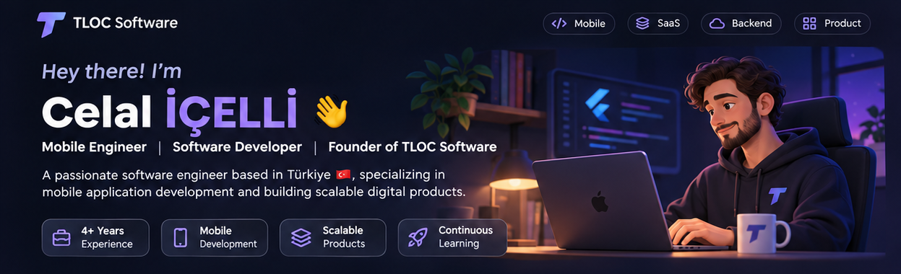
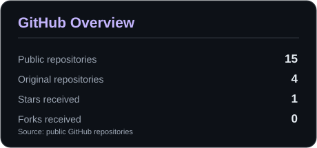
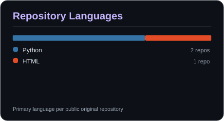

 

  
  
  

## 👋 About Me

I'm **Celal İÇELLİ**, a software engineer based in **Türkiye 🇹🇷** with **4+ years of professional mobile development experience**.

I specialize in building polished cross-platform applications with **Flutter**, while working across backend services, scalable architectures, and SaaS products. At **TLOC Software**, I turn ideas into useful, maintainable digital experiences.

- 📱 **Mobile:** Flutter, Dart, Firebase; expanding into native iOS with Swift & SwiftUI
- 🧩 **Backend:** Node.js, NestJS, PostgreSQL, Redis
- 🏗️ **Interests:** Multi-tenant SaaS, software architecture, automation, product engineering
- 🌍 **Mindset:** Build for real users, learn continuously, and think globally
- 🤝 **Collaboration:** Always happy to connect with fellow builders

## 🛠️ Tech Stack

**Mobile Development**

**Backend & Databases**

**Tools & Infrastructure**

## 🎯 Currently Focused On

- Designing reliable, intuitive mobile experiences
- Building scalable multi-tenant SaaS platforms
- Improving backend architecture and engineering workflows
- Deepening my native iOS knowledge with Swift & SwiftUI
- Turning promising product ideas into real-world applications

## 📊 GitHub Activity

<!-- Locally stored SVG cards, refreshed daily by GitHub Actions. -->
<picture>
  <source media="(prefers-color-scheme: dark)" srcset="./assets/stats-dark.svg" />
  <source media="(prefers-color-scheme: light)" srcset="./assets/stats-light.svg" />
  
</picture>

<picture>
  <source media="(prefers-color-scheme: dark)" srcset="./assets/languages-dark.svg" />
  <source media="(prefers-color-scheme: light)" srcset="./assets/languages-light.svg" />
  
</picture>

Automatically refreshed daily from public GitHub repository data. Language counts represent each original repository's primary language, not coding proficiency. Private repositories and contribution counts are excluded.

## 💜 Let's Connect

I'm interested in collaborating on mobile products, developer tools, and thoughtful SaaS experiences.

📫 **Email:** [birincisinifdeli@gmail.com](mailto:birincisinifdeli@gmail.com)  
💻 **GitHub:** [github.com/cllicll](https://github.com/cllicll)  
🏢 **Company:** TLOC Software

---

**Build with purpose. Learn continuously. Create something meaningful.** 🚀

